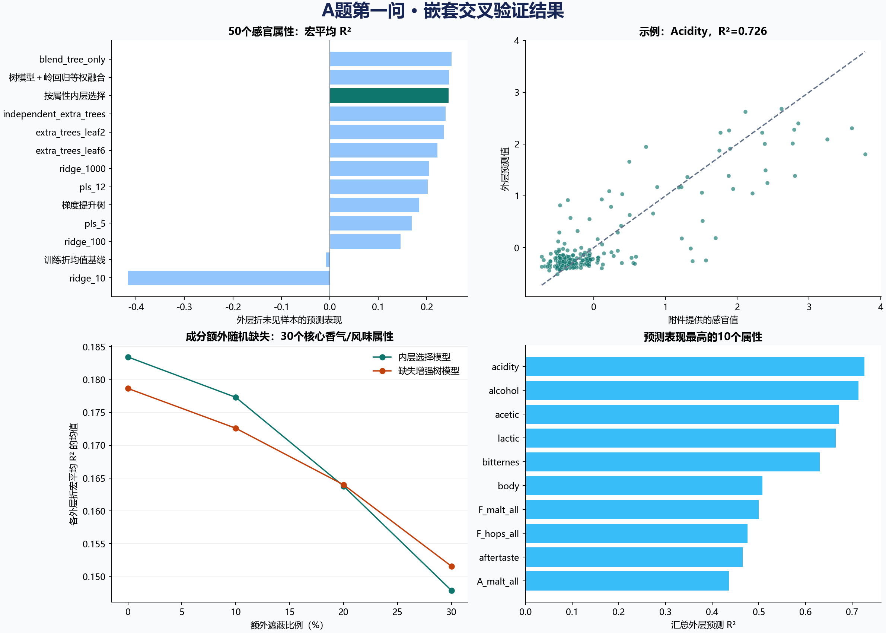

# A题第一问：分析、实现与首轮实验结果

后续已采用QDP与来源研究的七点强度量表，当前评分方案见[七点评分方案与结果](七点评分方案与结果.md)。本文保留首轮连续预测与历史相对分位数结果。

本次完成了数据审计、50维感官预测、嵌套交叉验证、缺失压力测试、逐属性区间实验、相对0—6级输出及可复用模型。原始人工0—6绝对评分无法从现有公开数据唯一恢复；相对等级属于显式建模假设，不能作为原始评分已还原的结论。

## 1. 第一问如何理解

输入为1.csv的231个化学/理化特征；训练目标为4.csv的50个感官属性。3.xlsx定义评分项目和表单结构。题面“约40维”与附件存在差异，本次首先覆盖可明确对应的全部50维，并把Aroma与Flavour各15维、合计30维作为核心指标单独评价。

3.xlsx实际有12张beer评分卡及summary。评分卡里的0是未填写输入时公式计算的默认值；不是12个已完成品评的训练样本。summary的50个属性可与4.csv逐项对应，需处理A_ester_fruity/A_esters_fruity、F_ester_fruity/F_esters_fruity、4vg/X4vg等命名差异。卡片另列的Acetaldehyde没有对应的独立Aroma/Flavour训练标签，本次不伪造该项目的分数。

## 2. 数据审计与预处理

- 样本：250；化学特征：231；感官属性：50。
- 化学缺失值：73/57750，约0.126%；感官标签无缺失。
- 按beer编号连接；beer_id部分已被科学计数法舍入，不能作为精确连接键。先后样本为beer 10和beer 157；不是按编号排序。
- 与8.xlsx的70个原始校准指标核验：37列符合log10表示，33列与原始值一致，其余161列的绝对浓度尺度尚未核实。pH和ethanol等在本附件中也符合log10表示。
- 建模保留1.csv已提供的数值表示，避免再次全表取对数；中位数插补与标准化仅在训练折拟合。低值及负值不会被直接删除或截为0。
- 不把风格、样本编号、论坛评论、附带SHAP/重要性结果作为化学预测模型的输入。

## 3. 原始评分尺度为什么尚未恢复

原始论文说明，感官评分按品评员分别中心化和标准差缩放；附件是处理后的汇总值。即便知道一个全局均值和标准差，也未必能反推每位品评员的原始评分与汇总过程。

作者Zenodo公开补充工作簿S1、S4的化学/感官数值列与本题1.csv、4.csv一致（最大浮点差异分别约8.9e-16和1.1e-16），按beer核对行；存在舍入的beer_id不参与数值一致性比较。其质控脚本引用Raw_Sensory_data_Trained_panel.csv，但该逐人原始表不在公开文件清单中。本次没有找到将标准化汇总分唯一还原成0—6绝对等级的锚点。

原始研究：[Nature Communications论文](https://doi.org/10.1038/s41467-024-46346-0)；[作者公开补充数据](https://zenodo.org/records/10653704)。下载来源与SHA-256见external_sources/manifest.json。

因此分开交付：①可验证的附件连续尺度预测；②假设下的0—6相对等级。后者的0表示相对低组，不能解释为“无此风味”。
不可辨识性的一个简单例子：若原始评分在不越界的范围内整体加一个常数，同时改变其均值，标准化后的值保持不变。因此没有原始尺度锚点时，仅凭标准化值不能确定原来的绝对分数。

## 4. 模型与验证设计

- 外层5折评价未见样本预测，内层3折按属性选择候选模型；固定种子20261024。每个样本只作为一次外层测试样本。
- 候选为3个正则强度的岭回归、2个潜变量数的PLS、2种叶节点限制的多目标ExtraTrees、逐属性ExtraTrees、逐属性直方图梯度提升树、两种固定等权融合及训练折均值基线。
- 首轮未约束的线性方法在极端特征样本上出现严重外推。修订版在线性与PLS分支加入训练折1%—99%分位数截尾，树模型保留原特征。首轮记录保存在experiments/initial_unbounded_linear，未隐藏失败结果。
- 各模型的特征及目标标准化在训练数据中拟合，按属性比较内层均方误差。测试标签不参与插补、选参、模型选择和等级映射。
- 不使用含自身标签训练得到的拟合值当作泛化成绩。报告指标来自外层预测。最终可复用模型随后才在全部250个样本上重新拟合。
- 外层为随机KFold；本次检验同一总体的新样本表现，没有证明新地区、新工艺或未见风格下的泛化。候选流程根据首轮诊断做过修订，结果属于本数据上的开发验证，最终仍应有独立外部验证。

数学上，建立X∈R^(250×231)、Y∈R^(250×50)。对第j个感官属性，使用训练折估计填补器I、截尾器C（仅线性分支）、标准化器S，再学习f_j，使训练感官值与预测值的平方误差尽量小。正则强度、潜变量数和模型家族由内层验证决定。最终输出ŷ_j=f_j(S(C(I(x))))，再通过独立说明的映射G_j得到临时相对等级。

## 5. 连续感官预测结果

- 全50维宏平均R²：**0.2448**。
- 核心30维Aroma/Flavour宏平均R²：**0.2010**。
- 汇总RMSE：0.4790；MAE：0.3402。两者均在附件提供的感官尺度上，不是原始0—6分误差。
- 相对训练折均值基线的汇总RMSE下降：17.32%。
- 全50维R²固定OOF预测的样本bootstrap 95%区间：[0.21578805383208044, 0.2628538850332826]。该区间不包含重训及重新划分训练集的全部不确定性。
- R²大于0的属性：48/50；不大于0的属性：2/50。不同属性可预测性差异明显。

| model | macro_r2 | core_macro_r2 | rmse_provided_scale |
| --- | --- | --- | --- |
| blend_tree_only | 0.2508 | 0.1982 | 0.4769 |
| blend_tree_linear | 0.2462 | 0.1977 | 0.4782 |
| nested_selected | 0.2448 | 0.2010 | 0.4790 |
| independent_extra_trees | 0.2389 | 0.1874 | 0.4803 |
| extra_trees_leaf2 | 0.2348 | 0.1987 | 0.4839 |
| extra_trees_leaf6 | 0.2218 | 0.1895 | 0.4897 |
| ridge_1000 | 0.2045 | 0.1603 | 0.4974 |
| pls_12 | 0.2017 | 0.1566 | 0.4949 |
| hist_gradient_boost | 0.1846 | 0.1177 | 0.4974 |
| pls_5 | 0.1692 | 0.1228 | 0.5089 |
| ridge_100 | 0.1463 | 0.1031 | 0.5098 |
| training_mean | -0.0074 | -0.0070 | 0.5794 |
| ridge_10 | -0.4166 | -0.4881 | 0.6537 |

各固定候选模型使用相同外层测试划分。按属性选择本身也在外层评价，因此不能保证它在这次有限样本中胜过所有固定模型；这里保留全部结果。

预测表现较好的属性：

| target | CleanName_PanelFeedback | r2 | rmse |
| --- | --- | --- | --- |
| acidity | Acidity | 0.7262 | 0.4483 |
| alcohol | Alcohol | 0.7138 | 0.4049 |
| acetic | Acetic acid | 0.6718 | 0.4276 |
| lactic | Lactic acid | 0.6652 | 0.4246 |
| bitternes | Bitterness | 0.6308 | 0.4433 |
| body | Body | 0.5080 | 0.3961 |
| F_malt_all | Malt taste - overall | 0.4995 | 0.4852 |
| F_hops_all | Hops taste - overall | 0.4755 | 0.5017 |
| aftertaste | Aftertaste | 0.4654 | 0.4536 |
| A_malt_all | Malt aroma - overall | 0.4356 | 0.5375 |

表现较弱的属性（保留负R²）：

| target | CleanName_PanelFeedback | r2 | rmse |
| --- | --- | --- | --- |
| F_esters_flower | Esters taste - floral | -0.0725 | 0.4295 |
| A_esters_flower | Esters aroma - floral | -0.0311 | 0.4298 |
| F_malt_grain | Malt taste - grain | 0.0158 | 0.4452 |
| clove | Clove | 0.0255 | 0.5511 |
| A_malt_grain | Malt aroma - grain | 0.0389 | 0.4473 |
| A_esters_fruity | Esters aroma - fruity | 0.0422 | 0.4928 |
| barnyard | Barnyard | 0.0457 | 0.4379 |
| metallic | Metallic | 0.0610 | 0.4708 |

R²约0代表接近均值预测，负值表示弱于均值预测。对于弱维度，不能仅因输出了一个数字，就解释为模型能够可靠识别这种气味。

## 6. 数据缺失条件下的表现

在每个外层测试折原有缺失基础上，额外随机遮蔽10%、20%、30%的特征单元，每档重复5次。填补器和模型只在训练折拟合，测试时不使用感官真值填补。重复先在折内平均，再汇总各折。0%仅指没有新增遮蔽，仍包含原始缺失。

另设一个训练时缺失增强的树模型对照：在训练样本的复制版本上分别遮蔽10%、20%、30%特征；所有复制版本都留在训练折内，避免同一啤酒同时进入训练和测试。

| method | additional_missing_rate | macro_r2 | core_macro_r2 | rmse | fold_sd_r2 |
| --- | --- | --- | --- | --- | --- |
| mask_augmented_extra_trees | 0.0000 | 0.2072 | 0.1787 | 0.4848 | 0.0264 |
| mask_augmented_extra_trees | 0.1000 | 0.2012 | 0.1726 | 0.4890 | 0.0217 |
| mask_augmented_extra_trees | 0.2000 | 0.1912 | 0.1640 | 0.4948 | 0.0151 |
| mask_augmented_extra_trees | 0.3000 | 0.1784 | 0.1516 | 0.5016 | 0.0135 |
| nested_selected | 0.0000 | 0.2175 | 0.1834 | 0.4786 | 0.0226 |
| nested_selected | 0.1000 | 0.2121 | 0.1773 | 0.4834 | 0.0170 |
| nested_selected | 0.2000 | 0.1985 | 0.1638 | 0.4910 | 0.0134 |
| nested_selected | 0.3000 | 0.1824 | 0.1479 | 0.4998 | 0.0123 |

此实验覆盖随机测量缺失（MCAR），没有证明低于检测限、仪器选择性缺测、整个化合物类别缺失等机制下的可靠性。
本表R²是各外层折R²的均值；前文主指标是在250个外层预测上汇总计算。两者的方差分母不同，因此0%新增缺失一行不必与主指标完全相同。

## 7. 0—6相对等级及尺度敏感性

主映射对每个属性使用训练折标签的经验分布F，将预测值映射为min(6,floor(7F))；重复值采用中秩。每一等级代表训练分布中的一个相对区间，不是原始品评强度的语义刻度。

另给一组显式假设：训练均值对应3分、低于均值2个标准差对应0分、高于2个标准差对应6分，中间线性转换后取最近整数并截断至0—6。

两种映射的等级不一致比例为64.90%，平均等级差为0.776。这是对尺度假设的敏感性，不是预测准确率。

对250个样本均交付连续OOF预测与相对等级；另按Beer# 1—12导出评分卡对应的12个样本，明确它们的相对等级性质。未把相对等级回填原始评分卡以冒充真实人工打分。

## 8. 独立区间预测实验

固定拆分150训练、50校准、50测试；所有选模仅用150个训练样本，50校准样本仅确定逐属性绝对残差分位数，最后50个测试样本仅评价覆盖率。名义逐属性覆盖率90%，有限样本分位数使用ceil((n_cal+1)*0.9)阶统计量。

测试集50个属性的平均覆盖率：88.72%；核心30属性平均覆盖率：89.87%。完整逐属性覆盖率及宽度在split_conformal_metrics.csv。平均覆盖率不能替代每个属性的实际表现。

区间保证依赖训练/校准/测试样本可交换等条件，不是50维同时覆盖保证，也不直接适用于第三问明显偏离训练分布的生成样本。此模型只用150个样本拟合，其点预测与最终250样本模型不同，不能混用两套点预测和区间半径。

## 9. 本轮结论与尚未解决的部分

第一问已形成可复现的连续感官预测方案，并量化不同属性、不同缺失率下的性能。不能将本轮结果描述成“全部感官维度都能准确预测”，也不能把相对分位数等级描述成原始人工评分恢复。

若要完成题面0—6绝对等级的严格校准，仍需原始逐人评分及标准化/汇总规则，或官方认可的原始分数锚点。仅凭现有标准化汇总表存在不可辨识性。新增真实校准数据后可在预测模型之后接入校准器，并用独立样本评价等级误差。

第二、三问可复用[统一预测模型](../问题结果/模型/question1_model.joblib)中的连续感官模型；同时应参考每个属性的误差和训练分布范围，不把低可预测性属性的输出当作确定事实。

## 10. 复现与核验

运行耗时：412.4秒（不含数据溯源、图表与报告）。验证：passed: nested fold isolation, finite predictions, grade bounds, serialization, unchanged source hashes。

数据字典、量纲核验、缺失统计、输入SHA-256、外层各折样本编号、逐属性选模、模型比较、压力测试原始记录和区间测试预测均随项目保存。运行命令及推理方法见项目README.md。
