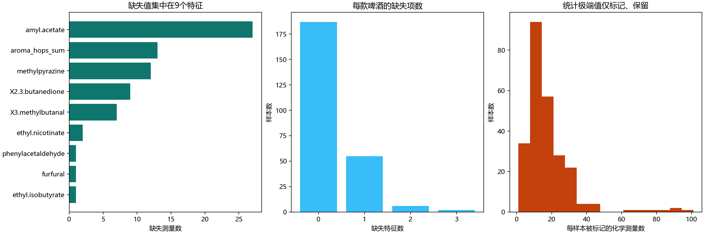

# 第一问数据清洗报告

已完成现有附件可执行的数据清洗、来源追溯及逐项质量核验。保留250个样本、231个特征和50个感官目标；不删除真实但极端的啤酒样本。

## 数据与清洗产物

清洗后的特征表和标签表位于 `数据表格/数据清洗/clean_features.csv`、`clean_targets.csv`。两表按beer对齐并使用化学表和8.xlsx共同确认的精确商品编号，修复了感官表213条舍入编号。数值训练输入与原附件保持一致，已核对CSV导出回读和原附件哈希。

缺失值保留为NA；中位数填补、线性/PLS分支的1%—99%裁剪和标准化均在训练折内拟合。清洗表不包含用全体250个样本计算后预先填补的值，避免交叉验证泄露。

## 重复、常量和缺失

- 重复化学特征行：0；重复感官行：0；重复化学列：0。
- 常量或全空特征：0；近乎相同的样本对：0（至少90%特征可比且最大IQR缩放差≤1e-6）。不因风格相同或感官值接近而去重。
- 缺失73处，占0.1264%，影响63款，每款最多缺3项。

| 特征 | 缺失数 | 样本占比 |
| --- | --- | --- |
| amyl.acetate | 27 | 10.80% |
| aroma_hops_sum | 13 | 5.20% |
| methylpyrazine | 12 | 4.80% |
| X2.3.butanedione | 9 | 3.60% |
| X3.methylbutanal | 7 | 2.80% |
| ethyl.nicotinate | 2 | 0.80% |
| ethyl.isobutyrate | 1 | 0.40% |
| furfural | 1 | 0.40% |
| phenylacetaldehyde | 1 | 0.40% |

已输出样本、特征、风格分布、共现模式和缺失掩码。9个缺失特征×22种风格共198个Fisher精确检验经BH多重校正后，显著关联数为1；未检出关联不能证明完全随机缺失，不将NA填为0。

- aroma_hops_sum：Hoppy组缺失6/17，其他风格缺失7/233，BH校正p=0.009975。

## 231列的尺度与来源

`feature_scales.csv`逐列列出名称、测量类型、源单位、变换证据和允许的解释。70列有校准参考：37列的正值与log10参考一致；33列以原值表示为主，但部分单元格存在跨表差异，不能仅凭中位数误差宣称全表一致。

另外161列分为157个未校准相对信号和4个合计信号。已确认它们不是可直接当作mg/L的绝对浓度：作者方法说明色谱峰面积经内标归一化，绘图脚本将未校准字段标为A.U.。公开表未提供其变换前逐列信号和完整变换清单，因此保留给定表示，不再次取对数，不反推或虚构浓度。信号类别已判明，精确逆变换不具备数据依据。

## 校准工作表与主表不一致的处置

逐单元格比较使用atol=rtol=1e-7，允许CSV舍入。发现：

- 与参考转换不一致：80处。
- 参考缺失、主表有数值：69处。
- 参考为0、主表为NA：60处，保留主表NA，不将其冒充已确认的真实0。
- 参考≤0、主表对应半个最小正值后取log10：758处。这是已有处理痕迹，不能把替代值说成仪器检出限。

作者公开S1、S4与比赛1.csv、4.csv的数值及缺失位置匹配；8.xlsx的校准表也与作者原表匹配。由此可确认上述跨表差异已经存在于上游公开资料，而非本次CSV读取错误。 保留比赛主表/S1，所有差异导出`calibration_cell_audit.csv`，未用辅助表覆盖主表。

## 异常值与物理范围

化学数据中4446个单元格被1.5IQR或6×1.4826MAD规则标记；感官表标记736个。IQR/MAD为零时不使用该规则。统计标记用于复核，不作为测量错误判据，不自动截断或删行。感官标签是标准化值，负数不等于错误。

最需复核的化学极端值示例（完整前20项及来源状态见`extreme_value_review.csv`）：

| beer | 特征 | 附件数值 | 稳健MAD偏离分数 |
| --- | --- | --- | --- |
| 156 | X2.methyltetrahydrofuran.3.one | 12596.43 | 266798.4 |
| 177 | E.caryophyllene | 40.92666 | 37579.1 |
| 181 | gamma.nonalactone | 7256.136 | 25551.0 |
| 151 | X.E..beta.damascenone | 5991.013 | 18346.2 |
| 9 | E.caryophyllene | 9.837583 | 9032.2 |

这些极端值也存在于作者公开处理表。来源一致只能排除本次转录/读取错误，不能证明峰识别、校准或批次处理正确。无原始色谱图和重复测量时，无法确定应替换成哪个真值；保留并标记，线性模型仍采用训练折内裁剪控制外推。

对校准原值检查非负性、pH的0—14范围、乙醇的0—100%范围，发现辅助校准表有3个负测量值（β-葡聚糖2处、不可发酵物1处）；对应主表已使用可核对的低端替代值。保留主表，逐项列于`physical_reference_flags.csv`。不使用“常见啤酒范围”删除特殊风格，不把感官阈值误当检测限或异常上界。

全12张评分卡都已检查：公式缓存0为未填写模板的默认结果，不用于感官训练，也不补造没有独立标签的乙醛子项目。

## 结论与适用范围

本轮完成了模型输入所需的清洗与核验，数值训练输入没有变化，现有模型及外层验证指标仍对应同一组输入；本轮未重新训练模型。准确复核测量误差、重做批次校正或反推全部浓度仍需要未公开的原始重复测量/色谱图、逐化合物LOD/LOQ和变换前信号，不能由本轮清洗凭空补齐。

依据：[作者论文方法](https://pmc.ncbi.nlm.nih.gov/articles/PMC10966102/)、[固定版本公开数据与脚本](https://zenodo.org/records/10653704)。来源比对与哈希见`数据表格/数据清洗/published_source_comparison.csv`，处理汇总见`元数据/cleaning_summary.json`。

